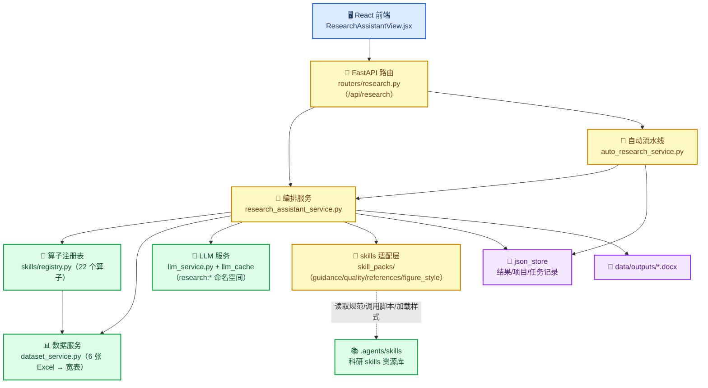
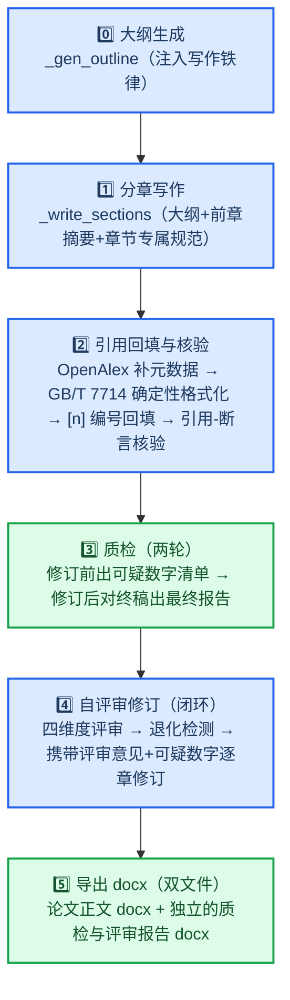

# 科研助手工作流程文档

> 版本：v2.3　　更新日期：2026-09-01　　对应代码：`services/research/`、`routers/research.py`、`frontend/src/views/portal/ResearchAssistantView.jsx`
>
> 本文档描述科研助手**当前**的完整工作流程（含 2026-09-01 引入的多阶段论文生成流水线与科研 skills 集成）。用户向功能介绍见《科研助手说明文档.md》。

## 📌 功能定位与两种模式

科研助手把「选题 → 分析 → 解读 → 论文撰写」封装为完整科研闭环，数据基础为郸城肿瘤血液科真实世界数据（3,990 名患者、13,743 次就诊、约 114 万条医嘱、5.5 万条检验、2 万条检查及 Neo4j 知识图谱）。

| 模式 | 面向用户 | 入口 | 工作方式 |
|---|---|---|---|
| 智能模式（默认） | 不懂算法的医生 | `/portal/research-assistant` 智能模式 | 推荐议题 → 一键自动研究 → 下载 Word 论文 |
| 专家模式 | 有分析基础的用户 | 同页面专家模式 | 自选 22 个算子、调参、查看解读、手动组装论文素材 |

## 🏗️ 总体架构

## 🤖 智能模式：自动研究流水线

`auto_research_service._run()` 在后台线程执行，前端每 3 秒轮询 `GET /api/research/auto/{job_id}` 获取步骤状态。

关键行为：

- 议题去重：已推荐过/已研究过的议题自动排除；`refresh=True` 跳过 LLM 缓存换一批
- 议题锦标赛排序（`_rank_topics`）：LLM 从数据可支撑性/临床意义/创新性批判性评估并重排候选议题，失败保持原顺序
- 文献检索：LLM 将中文议题译为 PubMed 检索式；多查询扩展（同义改写 + 上位概念）合并去重后按相关性重排，智能模式默认取 **15 篇**（专家模式检索上限 20 篇，论文最多引用 18 篇，`MAX_REFERENCES`）；失败不中断，论文将不带参考文献
- 算子失败不中断，但**至少 1 个算子成功**才进入论文生成
- **大纲人在环检查点**（借鉴 Co-Scientist scientist-in-the-loop）：算子完成后流水线生成大纲并暂停（job 状态 `awaiting_outline`），前端展示可编辑的大纲；用户确认/修改后 `POST /auto/{job_id}/outline` 唤起论文生成；大纲预览失败时跳过确认直接生成；用户留空大纲则回落自动锦标赛生成
- 论文生成步骤详情会附带质检提示数量（如"质检提示 2 处数字待核对"）

## 📝 核心：六阶段论文生成流水线

`research_assistant_service.generate_paper(question, result_ids, articles, title=None)` 于 2026-09-01 从"逐章节一次性生成"升级为多阶段流水线。**每个阶段失败都降级为原有行为，绝不中断主流程。**

各阶段详情：

| 阶段 | 实现 | 注入的 skill 能力 | 降级策略 |
|---|---|---|---|
| 0 大纲（锦标赛） | `_gen_outline`：生成两个候选大纲（温度 0.3/0.7），评审调用批判性择优/融合（借鉴 Co-Scientist 生成-反思-排序） | scientific-writing 写作铁律（`guidance.writing_rules()`） | 单候选/评审失败逐级降级；全失败用空大纲按固定章节写作 |
| 1 分章写作 | `_write_sections`，每章独立 LLM 调用；**摘要/文献综述/讨论双稿择优**（`_best_of_two`，借鉴 AI Scientist v2 树搜索的退化版 best-of-2）；**「文献综述」章节**按主题归纳参考文献进展并标注 [n]，无文献时给占位提示不调 LLM | 大纲 + 前序章节 200 字摘要（衔接）；「结果」禁因果动词、数字必须出自 facts；「讨论」注入 scientific-critical-thinking 方法学自查清单（`guidance.critical_checklist()`） | 单章失败保留错误占位文本；第二稿/评审失败回落第一稿 |
| 2 引用回填与核验 | `_backfill_citations` + `_verify_citations` | citation-management / paper-lookup：OpenAlex 免费 API 补卷期页/DOI（`references.enrich_articles`）；GB/T 7714-2015 **确定性模板**格式化（`references.format_gbt7714`，杜绝 LLM 编造卷期页）；LLM 仅在前言/讨论插入已有编号；**引用-断言核验**（借鉴 OpenScholar 自反馈环）：LLM 逐条判断被引文献摘要是否支持所在句论断，不支持的移除标记 | 断网/失败则跳过增强、回填或核验，保守保留原文 |
| 3 质检（两轮） | `quality.check_number_consistency` + `quality.run_skill_lints` | 数字一致性：正文数字 vs facts 池比对；lint：subprocess 调用 scientific-writing `lint_manuscript.py`、hypothesis-generation `lint_causal_claims.py`。**修订前**先跑一轮数字校验产出可疑清单供 Stage 4 闭环；**修订后**再对终稿出具最终报告 | 全部本地执行，任何异常返回空报告 |
| 4 评审修订（闭环） | `_review_paper` + `_revise_sections` | peer-review / scholar-evaluation 四维度 rubric（`guidance.review_dimensions()`：创新性/方法学/结果呈现/写作质量）；`_is_degenerate` 检测 LLM 死循环输出；修订 prompt **携带本章可疑数字清单**，要求逐条修正或删除（质检→修订闭环）；评审为空但存在可疑数字时也会修订 | 评审失败或输出退化则跳过评审；单章修订失败保留原文 |
| 5 导出 | `_build_docx` | scientific-visualization：Okabe-Ito 色盲友好调色板 + 出版级版式（`figure_style.apply_style()`）；markdown → Word 渲染（标题/加粗/表格）；真实数据表替换 `【表N（占位）】` | 样式文件缺失回落默认 matplotlib 样式 |

## 🛡️ 质量保障机制

### 数字一致性校验（防幻觉核心）

`check_number_consistency(sections, facts_pool)` 将正文每个数字与 facts 池比对，输出"正文出现但 facts 中不存在"的可疑数字清单（**召回优先的人工核对提示，非错误清单**）。

比对池来源：算子 facts + 算子 summary + 数据表行列 + 研究背景既定数字（13,743 / 3,990 / 826 / 85）。

预处理与过滤规则（均为防误报）：

| 规则 | 说明 |
|---|---|
| 千分位合并 | `13 743`、`3 990`（含不间断空格）合并为完整数值 |
| 科学计数法 | 正文 `p=2.30×10⁻⁸` 与 `p=5.19e-06` 两种记法整体提取；facts 字符串中的 `"2.30e-08"` 整体解析，不拆碎片 |
| 百分制换算 | facts 存 0.234 可匹配正文 23.4% |
| 相对容差 | 极小数值（p 值）按 5% 相对容差比对 |
| 结构数字过滤 | 小整数（<10）、年份（1900-2100）、章节编号（`3.1`）、阈值条件（`≥65`）不报 |
| 去重与上下文 | 同章节同数值只报一次；上下文取**完整句子**（不再用省略号截断） |

已知边界：LLM 的派生计算（如 `100-84.1=15.9`、`支持度×总数≈计数`）会被标记——这是**有意保留**的人工核对点。

### lint 脚本结果处理

lint 脚本（英文、面向其自带清单体系）的输出经两层过滤后才进入报告：

- 过滤基础设施类告警码（`CONFIDENTIALITY_GATE`、`MANIFEST`、`INTAKE` 等与论文内容无关）
- 规则码映射为中文说明（如 `PLACEHOLDER` → "存在未解决的占位符或 TODO 标记"、`CAUSAL` → "疑似因果表述"），未知名返回规则码本身，不输出英文长句

### 评审退化检测

`_is_degenerate(text)` 检测 LLM 死循环输出：任意 2-12 字符片段连续重复 ≥5 次，或长文本字符多样性 <8%，即判为退化——丢弃评审、跳过修订，避免"严谨专业严谨专业…"写入文档。

### docx 渲染管线

- LLM 输出的 markdown 标记正确渲染：`#` 标题行与整行 `**xx**` → 加粗小标题（与章节标题重复者跳过）；行内 `**粗体**` → 粗体 run；markdown 表格 → Word 表格
- 结果章节中 `【表N 标题（占位）】` 单独成行，按顺序替换为算子产出的真实数据表（Table Grid、表头加粗、≤20 行），未消耗的表追加到章节末尾；`【图N（占位）】` 删除，图表由 ECharts option → matplotlib PNG 嵌入
- **质检与自评审报告独立成文**：论文正文 docx 不含任何 AI 附录；`_build_report_docx` 单独生成《质检与评审报告_时间戳.docx》（数字校验清单 + lint 中文警告 + 四维度评审），接口返回 `report_download_url`，前端两种模式均有独立下载按钮

## 🎁 skills 适配层（skill_packs）

`services/research/skill_packs/` 把 `.agents/skills/` 下的科研 skill 封装为后端模块，**所有外部资源缺失/失败均优雅降级**：

| 模块 | 来源 skill | 能力 | 联网/依赖 |
|---|---|---|---|
| `paths.py` | — | 定位 `.agents/skills` 资源，缺失返回 None | 无 |
| `guidance.py` | scientific-writing、scientific-critical-thinking、peer-review、scholar-evaluation | 中文规范块注入 prompt（写作铁律/方法学清单/评审维度） | 无（内置提炼常量） |
| `quality.py` | scientific-writing、hypothesis-generation | 数字一致性校验（纯本地）+ lint CLI subprocess 调用 | 无（脚本离线） |
| `references.py` | citation-management、paper-lookup | OpenAlex 补全元数据 + GB/T 7714 确定性格式化 | 联网（OpenAlex 免费 API，失败原样返回） |
| `figure_style.py` | scientific-visualization | Okabe-Ito 调色板 + 出版级 rcParams | 无（缺失回落内置常量） |

未接入的 skill 及原因：research-lookup / literature-review（依赖商业 Parallel API）、citation-management 的 Google Scholar 脚本（爬虫易被封）、experimental-design / statistical-analysis 的 Python 库（当前算子体系暂无对应场景）。

## 🧮 算子清单（22 个，6 类）

| 类别 | 算子 id |
|---|---|
| 数据概览 | `dataset_profile`、`trend_analysis` |
| 数据挖掘 | `frequent_itemsets`、`association_rules`、`similar_items`、`cooccurrence_network`、`anomaly_detection` |
| 机器学习 | `classification`、`clustering`、`dimensionality_reduction`、`feature_importance`、`regression` |
| 统计分析 | `descriptive_stats`、`group_comparison`、`correlation` |
| 图谱挖掘 | `graph_overview`、`kg_comorbidity`、`centrality` |
| 论文写作 | `topic_suggestion`、`literature_search`、`paper_outline`、`paper_writing`、`reference_format`、`paper_review` |

新增算子方式：继承 `BaseSkill`、声明 `SkillMeta`、注册进 `registry.py:_ALL_SKILLS`，前端表单/执行接口/LLM 解读/自动流水线目录自动生效。

## 🔌 API 接口（/api/research）

| 方法 | 路径 | 说明 |
|---|---|---|
| GET | `/data-assets` | 数据资产清单 |
| GET | `/skills` | 按类别列出算子与参数 schema |
| POST | `/skills/{id}/run` | 执行算子（含 LLM 解读） |
| GET | `/results/{result_id}` | 取已存结果 |
| POST | `/code/run` | 自定义受限 pandas 代码 |
| POST | `/recommend` | LLM 推荐分析路径 |
| POST | `/interpret` | 重新生成结果解读 |
| POST | `/literature/search` | PubMed 文献检索 |
| POST | `/paper/generate` | 六阶段论文生成（返回 `paper`/`quality_report`/`review`/`download_url`） |
| GET | `/paper/download/{filename}` | 下载 docx（防路径穿越） |
| POST | `/auto/topics` | 推荐研究议题 |
| POST | `/auto/topics/custom` | 评估自定义研究设想 |
| GET | `/auto/history` | 历史研究记录 |
| POST | `/auto/start` | 启动自动流水线 |
| GET | `/auto/{job_id}` | 查询流水线状态（前端 3s 轮询） |
| POST | `/auto/{job_id}/outline` | 确认/修改大纲后继续论文生成（人在环检查点） |

## 🗂️ 缓存与存储

- LLM 缓存命名空间（`data/llm_cache/research_*.json`）：`research:interpret`、`research:recommend`、`research:paper_title`、`research:paper_outline_auto`、`research:outline_judge`、`research:paper_writing`、`research:section_judge`、`research:citation_backfill`、`research:citation_verify`、`research:reference_format`、`research:paper_review_auto`、`research:paper_revise`、`research:auto_query`、`research:auto_topics`、`research:topic_rank`、`research:literature_search_expand`、`research:literature_search_rerank`、`research:{skill_id}`
- 修改写作/评审 prompt 后需清理对应命名空间缓存才能生效
- 结果记录：`research_result_*`（json_store）；项目记录：`research_project_*`；自动任务：`autojob_*`（内存 + 终态落盘）
- 论文文件：`data/outputs/科研论文_YYYYMMDD_HHMMSS.docx`

## 🧪 测试与工具脚本

- `tests/test_skill_packs.py`：skill_packs 单测（数字一致性含千分位/科学计数法/去重/阈值过滤、GB/T 7714 格式化、lint 过滤映射、降级路径）
- `tests/test_paper_pipeline.py`：流水线 P0 机制单测（引用标记提取/移除、引用核验的 LLM 成败路径、质检→修订闭环的 prompt 携带）
- `scripts/generate_papers_smart.py`：命令行批量走智能模式生成论文（`python scripts/generate_papers_smart.py 3`），产物复制到 `output/`

## 📋 更新记录

| 日期 | 版本 | 变更 |
|---|---|---|
| 2026-08-21 | v1.0 | 初始版本（见《科研助手说明文档.md》） |
| 2026-09-01 | v2.0 | 接入 `.agents/skills` 科研 skills：论文生成升级为六阶段流水线；新增 skill_packs 适配层；参考文献改为 OpenAlex 增强 + GB/T 7714 确定性格式化；图表应用色盲友好出版级样式；新增数字一致性质检、lint 中文过滤、评审退化检测；docx 支持 markdown 渲染与真实表格替换；自动流水线新增文献检索步骤 |
| 2026-09-01 | v2.1 | 借鉴多智能体科研系统（Co-Scientist / OpenScholar）引入两个 P0 机制：①引用-断言核验——回填的 `[n]` 引用逐条与被引文献摘要做支持性判断，不支持的移除；②质检→修订闭环——数字质检提前至修订前，可疑数字清单随修订 prompt 逐章下发要求逐条处理，修订后再对终稿出具最终质检报告 |
| 2026-09-01 | v2.2 | P1/P2 四项优化：①大纲锦标赛择优（双候选+评审融合）与议题锦标赛排序（`_rank_topics`）；②文献检索多查询扩展+LLM 相关性重排；③摘要/讨论 best-of-2 双稿择优；④智能模式大纲人在环检查点——流水线在 `awaiting_outline` 状态暂停，前端可编辑大纲后确认继续（新增 `POST /auto/{job_id}/outline`，`generate_paper` 支持传入用户大纲跳过 Stage 0） |
| 2026-09-01 | v2.3 | 三项结构与规模优化：①参考文献扩量——智能模式检索 15 篇、论文最多引用 18 篇（`MAX_REFERENCES`），专家模式检索上限 20 篇；②新增「文献综述」章节（章节序列变为 摘要/前言/文献综述/资料与方法/结果/讨论/结论），按主题归纳参考文献并标注 [n]，纳入引用回填与引用-断言核验范围（`CITATION_SECTIONS`）及双稿择优范围；③质检与自评审报告从论文附录改为独立 docx 输出（`质检与评审报告_*.docx`），响应与 job 新增 `report_download_url`，前端两种模式新增"下载质检报告"按钮 |
